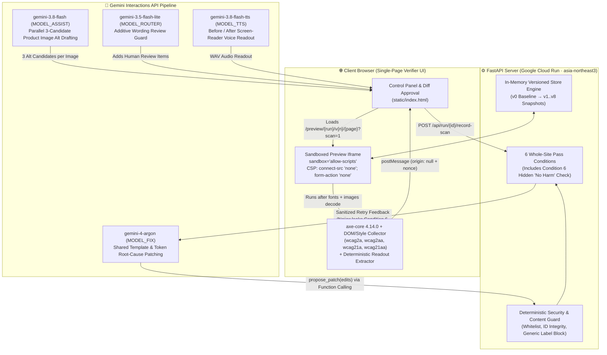
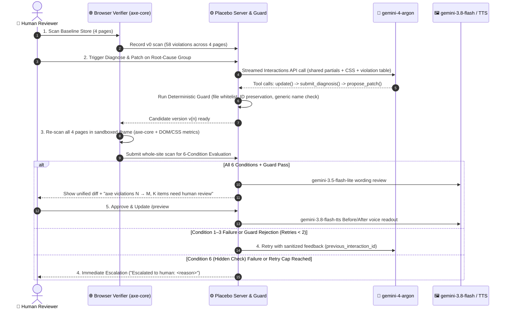

> [!IMPORTANT]
> **Post-hackathon note (2026-10-18):** The Cloud Run links below ran on the event's temporary Google Cloud account and stopped working after the hackathon, so the live app and replay links no longer load. The [3-minute demo video](https://youtu.be/2iEKS7V5sTE) shows the full run.

<div align="center">

# 💊 Placebo

### **Accessibility fixes that can't fool the checker. Hear the difference.**

[](https://soundcheck-129595935968.asia-northeast3.run.app/?replay=demo-run)
[](https://soundcheck-129595935968.asia-northeast3.run.app)
[](https://soundcheck-129595935968.asia-northeast3.run.app/?replay=demo-run)
[](https://youtu.be/2iEKS7V5sTE)
[](https://github.com/dequelabs/axe-core)

**[▶️ Watch 3-Min Demo Video (YouTube)](https://youtu.be/2iEKS7V5sTE)** · **[🎬 Watch Recorded Run Replay (No Token Needed)](https://soundcheck-129595935968.asia-northeast3.run.app/?replay=demo-run)** · **[🚀 Open Live Cloud Run App](https://soundcheck-129595935968.asia-northeast3.run.app)** · **[📄 Read Submission Summary](SUBMISSION.md)**

[](https://youtu.be/2iEKS7V5sTE)

</div>

---

> [!NOTE]
> Planning notes and throwaway feasibility checks (no product code) were prepared before kickoff; all code and the demo site were written after 11:20 KST (first commit 11:25).

---

## ⚡ Why Placebo Exists

An AI accessibility patch can make an automated linter report **zero violations** while leaving the page unusable for a blind shopper—for example by stamping `alt="image"` onto every product photo, setting `aria-label="button"` on icon controls, relying solely on `placeholder="Email"` without a `<label>`, or hiding low-contrast text with `display: none`.

At the same time, fixing one violation in isolation often breaks another page or surface: darkening a shared muted-text CSS token (`--color-text-muted`) to `#767676` fixes contrast on white cards (`4.54:1`) while introducing **12 new contrast failures** on dark `#1C1F26` headers and footers (`3.63:1`).

```text
┌───────────────────────────────────────────────────────────────────────────────────┐
│  BEFORE (v0 Baseline · 58 axe violations)                                         │
│  🔊 Screen-reader readout:  "button. link. button. image."                        │
├───────────────────────────────────────────────────────────────────────────────────┤
│  CHEATING PATCH (Scene A · 0 axe violations — FOOLED THE CHECKER)                 │
│  ❌ Guard Rejected:         alt="image" is not a description                      │
│  ❌ Condition 6 (Hidden):   Visible text dropped 936 → 811 chars (display:none)   │
├───────────────────────────────────────────────────────────────────────────────────┤
│  NAIVE CONTRAST FIX (Scene B · 58 → 53 violations — REGRESSION CAUGHT)            │
│  ❌ Condition 2 Rejected:   12 new contrast failures on dark header & footer      │
├───────────────────────────────────────────────────────────────────────────────────┤
│  AFTER SOUNDCHECK + HUMAN APPROVAL (v8 · 58 → 0 violations, 26 human reviews)     │
│  🔊 Screen-reader readout:  "Search. Cart. Menu. Navy wool coat."                 │
└───────────────────────────────────────────────────────────────────────────────────┘
```

---

## 🏗️ System Architecture



### Multi-Model Role Division

| Role Env Var | Default Model | Thinking Level | Responsibility in Placebo |
| :--- | :--- | :---: | :--- |
| `MODEL_FIX` | `gemini-4-argon` | `medium` | Diagnoses multi-page root causes across shared HTML partials (`partials/*.html`) and CSS tokens (`css/*.css`), and proposes unified source patches via manual function calling (`update`, `submit_diagnosis`, `propose_patch`, `escalate_group`, `read_file`, `run_scan`). |
| `MODEL_ASSIST` | `gemini-3.8-flash` | `low` | Inspects each product/banner JPEG (`img/*.jpg`) as a separate multimodal image part and drafts **3 concise `alt` candidates per image in parallel** for human selection. Content image `alt` text never goes through Argon. |
| `MODEL_ROUTER` | `gemini-3.5-flash-lite` | `low` | Reviews unified diffs for visible copy/label changes and **adds** items to the human-review checklist (can never remove items or approve a patch). |
| `MODEL_TTS` | `gemini-3.8-flash-tts` | — | Voices the deterministically extracted screen-reader readout before (`"button. link. button. image."`) and after (`"Search. Cart. Menu. Navy wool coat."`). |
| Store Assets | `gemini-nano-banana-2.1` | — | Generated the 7 product and promotional photographs in `img/` during the hackathon. |

---

## 🔄 Five-Step Verification & Repair Loop



---

## 🛡️ Six Whole-Site Pass Conditions & Deterministic Guard

Every candidate patch is evaluated across **all 4 storefront pages** (`index.html`, `product.html`, `cart.html`, `checkout.html`). A model **never** decides pass/fail.

| Check | Rule / Condition | What It Catches |
| :--- | :--- | :--- |
| **Condition 1** | **Targeted keys eliminated** | Every targeted `(page, rule, selector)` violation in the group must be gone across all 4 pages. |
| **Condition 2** | **Zero new violations site-wide** | Blocks cross-page regressions (such as **Scene B**, where `--color-text-muted: #767676` fixes white cards but breaks 12 dark header/footer elements). |
| **Condition 3** | **Zero serious/critical among targeted or new keys** | Ensures no high-severity accessibility barriers remain in the targeted group or newly touched nodes. |
| **Condition 4** | **Clean runtime** | Zero `window.onerror` exceptions, no iframe load timeouts, and complete `axe.run` execution on all 4 pages. |
| **Condition 5** | **Strictly below baseline** | Total site-wide violations must drop strictly below baseline (`58 → M`). |
| **Condition 6** *(Hidden)* | **Hidden "No Harm" Check** *(Patch model never saw this check)* | Per page, counts of `<a>`, `<button>`, `<input>`, `<select>`, ``, and **visible text length** must not decrease, and no new `display:none`, `visibility:hidden`, `opacity:0`, `font-size:0`, `color:transparent`, `clip`, `clip-path`, or off-screen positioning rules may be introduced. Any failure triggers **immediate human handoff** without leaking check details to the model. |
| **Deterministic Guard** | **Content & Security Guard** | Rejects non-whitelisted files, any added/removed/changed `id` attributes, generic placeholder names (`image`, `photo`, `picture`, `icon`, `button`, `link`, `img`, filenames), `role="presentation"` or empty `alt=""` on content images, and form inputs named only by `placeholder` or `title`. |

---

## 📊 Measured End-to-End Results (`replays/demo-run.json`)

> [!IMPORTANT]
> **Final Outcome**: `axe violations 58 → 0, 26 items need human review`  
> **Cloud Run Live Argon Latency**: `13.9 s` and `16.2 s` per streamed diagnose-and-patch round

| Version | Group / Scene | Engine / Source | Violations (`4 pages`) | Guard | Condition 6 (Hidden) | Verdict & Key Detail |
| :---: | :--- | :--- | :---: | :---: | :---: | :--- |
| **`v0`** | **Baseline Store** | Planted defects (`STORE_PROMPT.md`) | **58** | — | — | `button-name`: 8 · `color-contrast`: 17 · `html-has-lang`: 4 · `image-alt`: 13 · `label`: 4 · `link-name`: 12 |
| **`v1`** | **Scene A: Cheating Patch** | Pre-built cheating patch *(not model output)* | **0** *(fooled axe)* | ❌ **Rejected** | ❌ **Failed** | Guard catches `alt="image"`, `aria-label="button"`, `placeholder="Email"`; Condition 6 catches visible text drop **`936 → 811`** (`125` chars hidden via `display:none`). |
| **`v2`** | **Scene B: Naive Contrast Fix** | Pre-built naive fix (`#767676`, *not model output*) | **53** | ✅ Pass | ✅ Pass | ❌ **Rejected by Condition 2**: fixes 17 light-background nodes (`4.54:1`) but introduces **12 new failures** on dark `#1C1F26` header/footer (`3.63:1`). |
| **`v3`** | **`image-alt`** | `gemini-3.8-flash` (3 candidates/img) + Human Pick | **58 → 45** | ✅ Pass | ✅ Pass | ✅ **Approved**: 13 content images across 4 pages updated deterministically after human pick (`15` review items logged). |
| **`v4`** | **`tokens`** | `gemini-4-argon` (`css/tokens.css`, `css/styles.css`) | **45 → 28** | ✅ Pass | ✅ Pass | ✅ **Approved**: Splits `--color-text-muted: #595959` (light body) and `--color-text-muted-on-dark: #A6ADBB` (dark header/footer). |
| **`v5`** | **`header`** | `gemini-4-argon` (`partials/header.html`) | **28 → 20** | ✅ Pass | ✅ Pass | ✅ **Approved**: Adds `aria-label="Search"` and `aria-label="Menu"` to shared header icon toggles across all 4 pages. |
| **`v6`** | **`link`** | `gemini-4-argon` (`partials/header.html`, `partials/footer.html`) | **20 → 8** | ✅ Pass | ✅ Pass | ✅ **Approved**: Names shared Cart link (`aria-label="Cart"`) and footer social links across all 4 pages. |
| **`v7`** | **`form`** | `gemini-4-argon` (`partials/newsletter.html`) | **8 → 4** | ✅ Pass | ✅ Pass | ✅ **Approved**: Adds explicit `<label for="newsletter-email">` in shared newsletter partial across all 4 pages. |
| **`v8`** | **`lang`** | `gemini-4-argon` (`partials/layout-top.html`) | **4 → 0** | ✅ Pass | ✅ Pass | ✅ **Approved**: Sets `<html lang="en">` in shared layout-top partial. Final readout: **`"Search. Cart. Menu. Navy wool coat."`** |

---

## 🎯 Spotlight: The Dual-Context Token Trap (Scene B vs. Argon `v4`)

In the baseline storefront (`v0`), a single CSS custom property `--color-text-muted: #8C8C8C` is used in two different surface contexts:
1. **Light surfaces (`#FFFFFF` / `#FAF8F5`)**: 17 product meta, shipping, and form hint elements (`3.36:1` — fails WCAG AA `4.5:1`).
2. **Dark surfaces (`#1C1F26`)**: 12 header banner, cart count, and footer elements (`4.90:1` — passes WCAG AA on dark backgrounds).

```diff
/* ❌ Scene B — Naive Per-Violation Fix (Rejected by Condition 2: 12 new failures on #1C1F26) */
-  --color-text-muted: #8C8C8C;
+  --color-text-muted: #767676; /* 4.54:1 on #FFFFFF (passes), but 3.63:1 on #1C1F26 (breaks 12 nodes!) */

/* ✅ v4 — Gemini 4 Argon Surface-Role Token Split (45 → 28 violations, 0 regressions) */
-  --color-text-muted: #8C8C8C;
+  --color-text-muted: #595959;         /* 7.00:1 on #FFFFFF light cards */
+  --color-text-muted-on-dark: #A6ADBB; /* 6.33:1 on #1C1F26 dark header & footer */
```

---

## 🔍 Scene D: Real-World Template Scan (`inputs/aviato/`)

Placebo also scans 5 pages (`index.html`, `shop.html`, `product-single.html`, `cart.html`, `checkout.html`) from the open-source **Themefisher Aviato** Bootstrap e-commerce template (scan + diagnosis only; never modified) and highlights three real-world patterns labeled **`"Passes axe — flagged by Placebo"`**:

1. **Generic non-descriptive `alt` / `aria-label` values** (`alt="product-img"`, `alt="image"`).
2. **Focus outline removed in CSS** (`:focus { outline: 0 }`) without a visible `:focus-visible` replacement.
3. **Form controls relying only on `placeholder`** without a programmatic `<label>`.

---

## 📁 Repository Structure

```text
placebo/
├── main.py                  # FastAPI server, /preview renderer, SSE stream, 6-condition evaluator
├── gemini_agent.py          # Gemini Interactions API wrapper, manual function-calling loop, spend meter
├── guard.py                 # Deterministic Guard, Condition 6 Hidden Check, Aviato static checks
├── store_engine.py          # Server-side partial assembler (<!--#include file="..." -->) & pre-built scenes
├── static/
│   ├── index.html           # Single-page Verifier UI, sandboxed iframe runner, diff approval & replay
│   └── axe.min.js           # Offline axe-core v4.14.0 (MPL-2.0 header preserved)
├── store/                   # 4-page "Bukchon Wool" demo store + 4 shared partials + tokens.css/styles.css
├── img/                     # 7 storefront product/banner JPEGs generated with gemini-nano-banana-2.1
├── inputs/aviato/           # 5 script-stripped pages + style.css + MIT LICENSE from Themefisher Aviato
├── replays/
│   └── demo-run.json        # Recorded full-site trace (v0..v8 + embedded Gemini TTS WAV readouts)
├── DEFECTS.md               # Planted-defect manifest & dual-context token trap specification
└── SUBMISSION.md            # Hackathon submission descriptions & 3-minute video script
```

---

## 🚀 Local Development & Cloud Run Deployment

### Run Locally
```bash
uv venv --python 3.13
uv pip install fastapi "uvicorn[standard]" "google-genai>=2.30.1" python-dotenv
uvicorn main:app --host 127.0.0.1 --port 8080
```

### Deploy to Google Cloud Run (`asia-northeast3`)
```bash
gcloud run deploy soundcheck \
  --source . \
  --region asia-northeast3 \
  --allow-unauthenticated \
  --max-instances 1 \
  --min-instances 1 \
  --concurrency 20 \
  --timeout 180 \
  --memory 1Gi \
  --set-secrets=GEMINI_API_KEY=gemini-api-key:latest,DEMO_TOKEN=demo-token:latest \
  --set-env-vars=DEMO_MODE=1,COST_MODE=save,MODEL_FIX=gemini-4-argon,MODEL_ASSIST=gemini-3.8-flash,MODEL_ROUTER=gemini-3.5-flash-lite,MODEL_TTS=gemini-3.8-flash-tts,THINKING_FIX=medium,THINKING_ASSIST=low,THINKING_ROUTER=low
```

> [!TIP]
> **Public Replay vs. Live Runs**: Opening [`/?replay=demo-run`](https://soundcheck-129595935968.asia-northeast3.run.app/?replay=demo-run) works without a token and lets anyone inspect all 9 versions (`v0`–`v8`), diffs, 6 pass conditions, Scene D findings, and cached Gemini TTS audio. Live model endpoints require `X-Demo-Token` (`"Live runs need a demo token to cap spend; ask at our table."`).

---

## 📜 Credits & Licenses

- Manual function-calling loop adapted from the official Google Gemini Cookbook [`quickstarts/Function_calling.ipynb`](https://github.com/google-gemini/cookbook/blob/main/quickstarts/Function_calling.ipynb) (Apache-2.0).
- In-browser accessibility engine: [`axe-core` v4.14.0](https://github.com/dequelabs/axe-core) by Deque Systems, Inc. (MPL-2.0, header preserved in `static/axe.min.js`).
- Real-input diagnostic fixture (`inputs/aviato/`): [`themefisher/aviato-bootstrap`](https://github.com/themefisher/aviato-bootstrap) `@df6686f8cd7756393d65aae3fa23b9257985765a` (MIT, `LICENSE` preserved in `inputs/aviato/LICENSE`, all `<script>` tags stripped).
- Product images generated with `gemini-nano-banana-2.1` during the hackathon.
